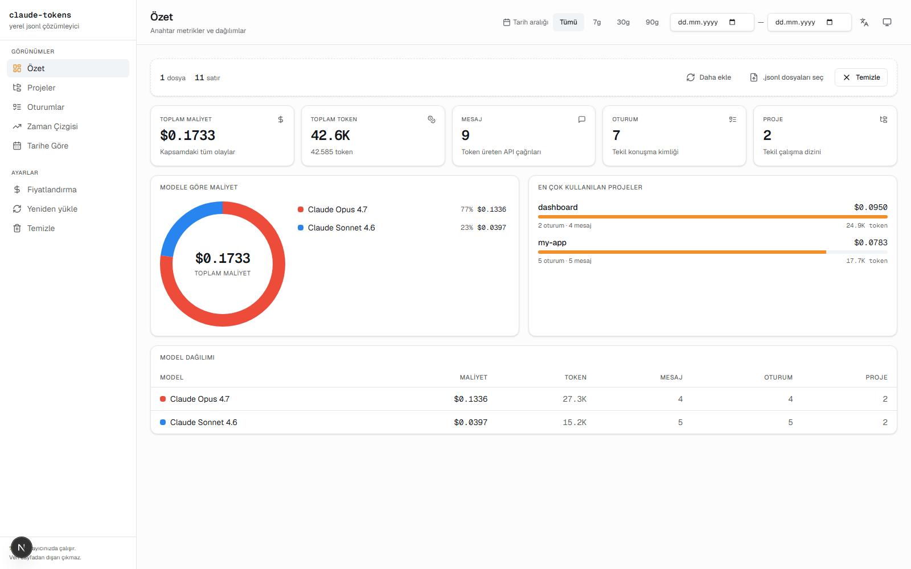
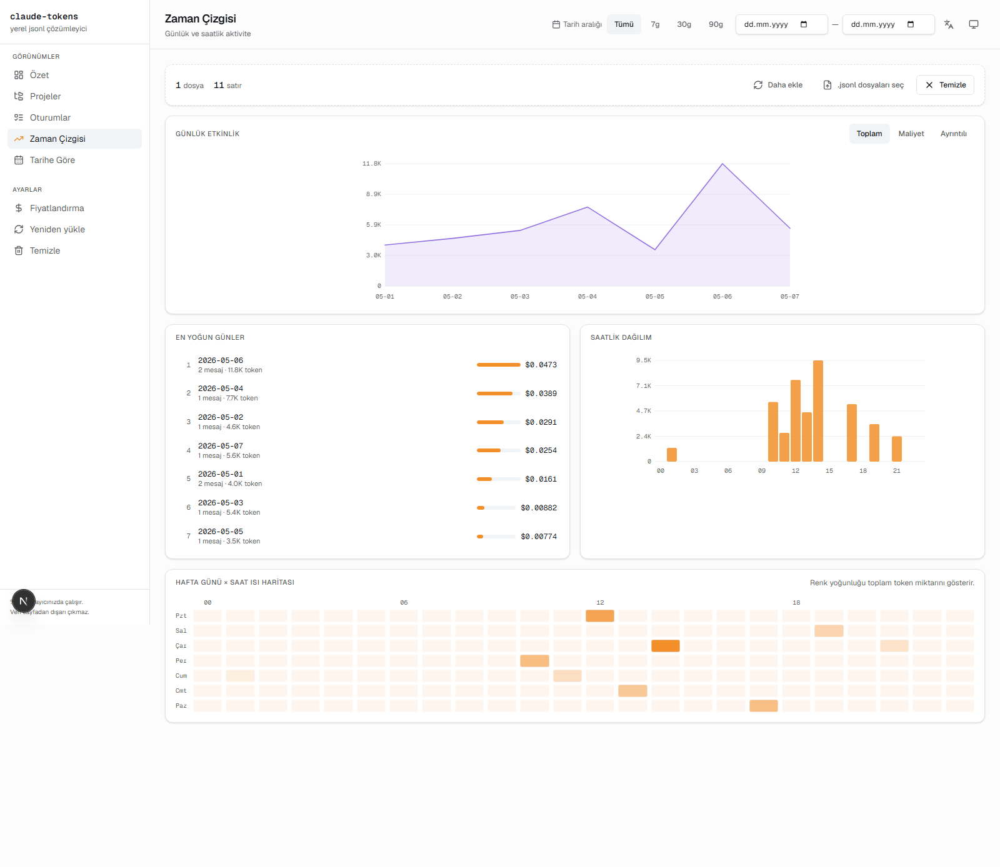
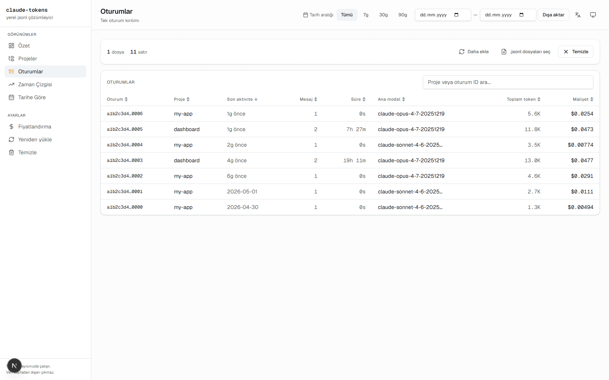

<div align="center">

# Claude Token Dashboard

**Claude Code oturumlarınızın token tüketimini ve maliyetini, hiçbir veri tarayıcı dışına çıkmadan analiz eden hafif bir web panosu.**

A lightweight web dashboard that analyses your Claude Code session token usage and cost — entirely in your browser, no data leaves the page.

[](./LICENSE)
[](https://nextjs.org)
[](https://tailwindcss.com)
[](https://www.typescriptlang.org)

[Canlı Demo / Live Demo](https://<your-user>.github.io/<repo-name>/)
[Lisans / License](./LICENSE) · [Katkı / Contributing](#katkı)
  
[English](#english) · [Türkçe](#türkçe)

</div>

---

## English

### What is it?

Claude Code stores a `.jsonl` log per session locally. This dashboard reads those files **directly in your browser** and shows:

- Total and detailed token usage (input / output / cache read / cache write)
- Estimated cost in USD using Anthropic's official pricing
- Project, session, day, hour, and model breakdowns
- Trend charts and sortable tables

**No file or data is ever sent to a server.**

### Screenshots





### Quick start

```bash
git clone https://github.com/<your-user>/claude-token-dashboard.git
cd claude-token-dashboard
npm install
npm run dev
# http://localhost:3000
```

Once it's open, drag your `~/.claude/projects` folder onto the dashboard (on Windows: `%USERPROFILE%\.claude\projects`).

### Production build

```bash
npm run build         # for Vercel / Node deploy
npm run build:static  # static export — runs on any static host
```

### GitHub Pages deployment

Every push to `main` builds and deploys the static export to the `gh-pages` branch.

1. In GitHub, open **Settings → Pages → Source** and select `gh-pages`.
2. Ensure Actions has `Read and write permissions`.
3. After the first run, your live URL is `https://<your-user>.github.io/<repo-name>/`.

To verify the static output locally:

```bash
npm run build:static
npx serve out
```

### Scripts

| Script | Description |
|---|---|
| `npm run dev` | Dev server (HMR). |
| `npm run build` | Production build. |
| `npm run start` | Serve the production build locally. |
| `npm run lint` | ESLint + type check. |
| `npm run test` | Vitest unit tests (domain + application). |
| `npm run test:e2e` | Playwright critical-flow tests. |

### Architecture

Four layers under `src/`: `domain → application → infrastructure → presentation`.
Dependencies point inward only. Details: [`docs/ARCHITECTURE.md`](./docs/ARCHITECTURE.md).

```
src/
├── domain/         # Pure business logic (parsing, pricing, aggregation)
├── application/    # Use cases
├── infrastructure/ # localStorage, file reading, dictionary loading
├── presentation/   # Next.js pages + React components
└── shared/         # Helpers, types, constants
```

### Privacy

- No `.jsonl` file ever leaves the browser.
- `localStorage` only stores theme, language, and pricing overrides.
- No telemetry, no third-party trackers.

### Roadmap

Full version in [`docs/PRD.en.md`](./docs/PRD.en.md); short version:

- **v0.1** — MVP: 5 views, 2 languages, pricing editor.
- **v0.2** — CSV/JSON export, budget gauge.
- **v0.3** — Project comparison, tagging.
- **v0.4** — Optional PWA mode (offline).
- **v1.0** — Stable release.

### Contributing

PRs welcome — please open an issue first. When you add new strings, **update both `tr.json` and `en.json`** (CI fails on missing keys).

### License

[MIT](./LICENSE)

---

## Türkçe

### Nedir?

Claude Code, her oturumunuz için yerelde bir `.jsonl` log dosyası tutar. Bu pano söz konusu dosyaları doğrudan tarayıcınızda okuyup:

- Toplam ve detaylı token tüketimini (giriş / çıkış / cache okuma / cache yazma)
- Anthropic resmi fiyatlandırması üzerinden tahmini maliyeti (USD)
- Proje, oturum, gün, saat ve model bazlı kırılımları
- Trend grafiklerini ve sıralanabilir tabloları

…güvenli bir şekilde gösterir. **Hiçbir dosya/veri sunucuya gönderilmez.**

### Ekran görüntüleri


### Hızlı başlangıç

```bash
git clone https://github.com/<kullanici>/claude-token-dashboard.git
cd claude-token-dashboard
npm install
npm run dev
# http://localhost:3000
```

Tarayıcıda açıldıktan sonra `~/.claude/projects` klasörünü pano üzerine sürükleyip bırakın (Windows'ta: `%USERPROFILE%\.claude\projects`).

### Üretim derlemesi

```bash
npm run build         # Vercel/Node deploy için
npm run build:static  # Statik export — herhangi bir static host'ta çalışır
```

### GitHub Pages dağıtımı

Bu repo `main` branch'ine her push'ta otomatik olarak `gh-pages` branch'ine deploy edilir.

1. GitHub'da **Settings → Pages → Source** altında `gh-pages` branch'ini seçin.
2. Actions izninin `Read and write permissions` olduğundan emin olun.
3. İlk deploy sonrası demo URL'niz: `https://<kullanici>.github.io/<repo-adi>/`.

Yerelde statik çıktıyı doğrulamak için:

```bash
npm run build:static
npx serve out
```

### Komutlar

| Komut | Açıklama |
|---|---|
| `npm run dev` | Geliştirme sunucusu (HMR). |
| `npm run build` | Üretim derlemesi. |
| `npm run start` | Üretim derlemesini yerelde sunar. |
| `npm run lint` | ESLint + tip kontrolü. |
| `npm run test` | Vitest birim testleri (domain + application). |
| `npm run test:e2e` | Playwright kritik akış testleri. |

### Mimari

`src/` altında dört katman: `domain → application → infrastructure → presentation`.
Bağımlılıklar sadece içe doğrudur. Detay: [`docs/ARCHITECTURE.md`](./docs/ARCHITECTURE.md).

```
src/
├── domain/         # Saf iş mantığı (parsing, fiyatlandırma, agregasyon)
├── application/    # Use case'ler
├── infrastructure/ # localStorage, dosya okuma, sözlük yükleme
├── presentation/   # Next.js sayfaları + React bileşenleri
└── shared/         # Yardımcılar, tipler, sabitler
```

### Gizlilik

- Hiçbir `.jsonl` dosyası ağa çıkmaz.
- `localStorage` yalnızca tema tercihi, dil ve fiyat override'larını saklar.
- Telemetri yoktur. Üçüncü taraf izleyici eklenmez.

### Yol haritası

[`docs/PRD.md`](./docs/PRD.md) içinde detaylı; özet:

- **v0.1** — MVP: 5 görünüm, 2 dil, fiyat editörü.
- **v0.2** — CSV/JSON export, bütçe göstergesi.
- **v0.3** — Proje karşılaştırma, etiketleme.
- **v0.4** — Opsiyonel PWA modu (offline).
- **v1.0** — Stabil sürüm.

### Katkı

PR'lar memnuniyetle karşılanır. Lütfen önce bir issue açın; yeni metin eklediğinizde **hem `tr.json` hem `en.json`'a** ekleyin (CI eksik anahtarlar için fail eder).

### Lisans

[MIT](./LICENSE)


---

👤 **Author:** [Kadir Çabuk](https://github.com/CabukKadir10) · [Medium](https://medium.com/@Kadir_cbk)
